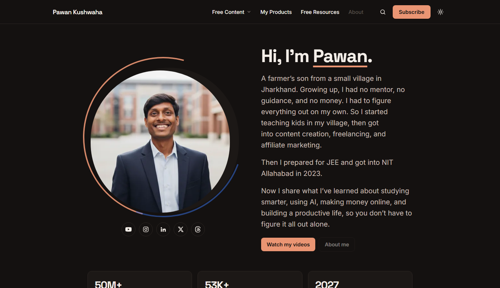
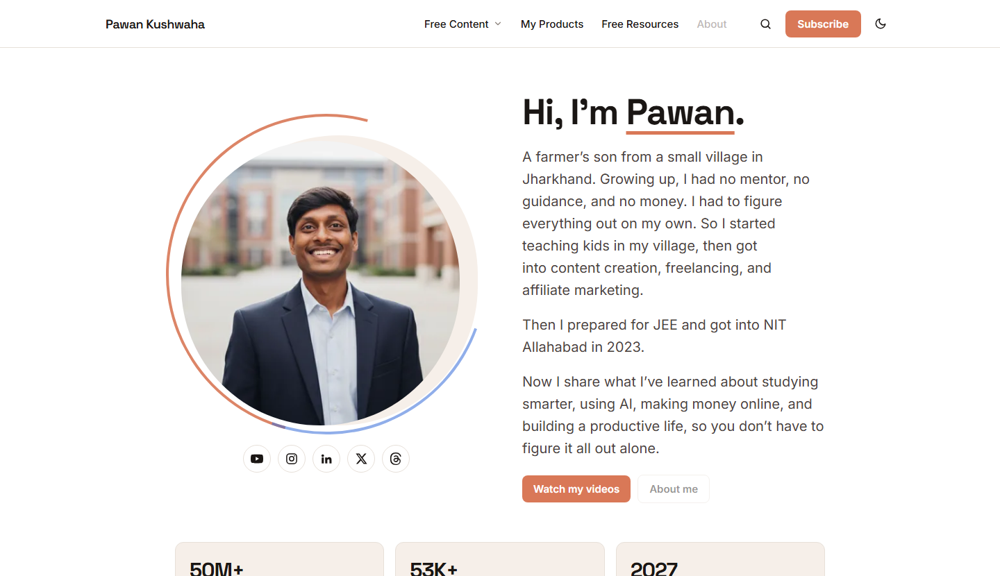
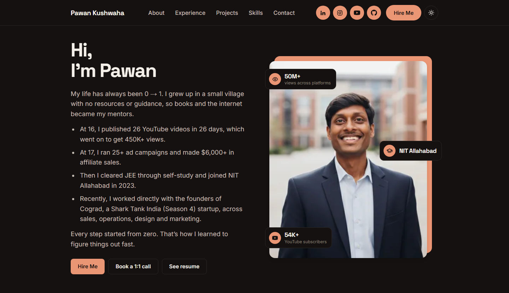
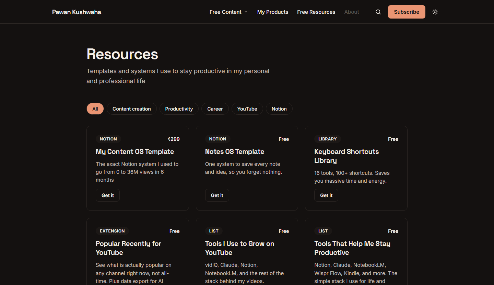
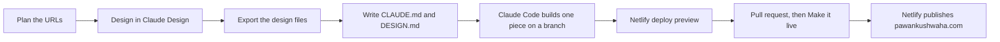
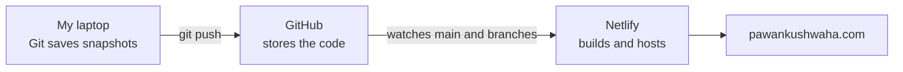

# pawankushwaha.com

**Bottom line:** I designed, built and shipped my own blog and portfolio from scratch, and it is live today. It is a fast static site made with Claude Design (the look), Claude Code (the build), Astro (the framework), GitHub (version control) and Netlify (free hosting). This page shows the stack, the exact workflow, and how Git and GitHub fit in.

## Links

| What | Where |
|---|---|
| Live site (Home) | https://pawankushwaha.com |
| Portfolio | https://pawankushwaha.com/portfolio/ |
| Free Resources | https://pawankushwaha.com/resources/ |
| My first product (Chrome extension) | [Popular Recently for YouTube on the Chrome Web Store](https://chromewebstore.google.com/detail/popular-recently-for-yout/nphahjnjpaijlboednofolnnmfkplomh) |
| Other projects on my GitHub | [Popular Recently for YouTube](https://github.com/Pawankkushwaha/Popular-Recently-for-YouTube), [YouTube Goal Tracker](https://github.com/Pawankkushwaha/yt-goal-trackerr), [Social Media Analytics Tracker](https://github.com/Pawankkushwaha/social-media-analytics-tracker), [Marketing Funnel Analysis](https://github.com/Pawankkushwaha/marketing-funnel-analysis-google-sheet) |
| YouTube | https://www.youtube.com/@iampawankushwaha |

## What it looks like

**Home (dark and light mode)**




**Portfolio**



**Free Resources**



## The problem

I had my work spread across several small Netlify sites and no single home for it. I wanted one place for my articles, book summaries, videos, free resources, products and portfolio.

My rules for that place:

- It must be free to run.
- It must be fast.
- It must be easy for Google and AI search tools to read.
- I must own the content as plain files, so I can move hosts any time.

I first planned this on WordPress. On 2026-09-23 I switched to Astro + GitHub + Netlify, because plain files and a free host fit those four rules better.

## What it does

- Serves a Home page, a standalone Portfolio and a Free Resources hub. All three are live.
- Has a shared header and footer. Pages that are not ready show as grayed-out links, so visitors can see what is coming.
- Has built-in search (Ctrl+K) powered by Pagefind, which runs fully in the browser with no server.
- Switches between dark and light mode.
- Works on phone, tablet and desktop.
- Adds SEO data to every page: title, description, canonical link, social preview tags and structured data.
- Keeps preview links out of Google automatically.

## Built with

| Layer | Tool | What it does for me |
|---|---|---|
| Design | **Claude Design** | I designed every page and the design system here first |
| Build assistant | **Claude Code** (in VS Code) | Writes the code from my design files and my rules |
| Framework | **Astro 7** (fully static) | Turns templates into plain, fast HTML pages |
| Content | Markdown + **MDX** | Posts will be plain text files, not database rows |
| Search | **Pagefind** | Fast search with no server |
| Images | **Sharp** + Astro images | Resizes images and serves modern formats |
| SEO | Astro **sitemap** integration, a shared SEO component | Same SEO tags on every page |
| Fonts | Space Grotesk and Inter | Loaded through Astro's font support |
| Version control | **Git** 2.55 | Saves every change as a snapshot on my laptop |
| Code hosting | **GitHub** (private repo) + **GitHub CLI** | Stores the code and handles pull requests |
| Hosting | **Netlify** free plan, Node 24 | Builds and publishes the site from GitHub |
| Domain | Namecheap (DNS) | Points pawankushwaha.com to Netlify |
| Editor and terminal | VS Code with the Astro extension, PowerShell | Where I read and run everything |
| Project notes | Notion build guide, plus `CLAUDE.md` and `DESIGN.md` in the repo | My written rules, so every session starts with the same context |

## How I built it: the complete workflow



**Step 1: Plan the site and the URLs**
- I modelled the structure on a site I admire, aliabdaal.com.
- I locked the URL map before building, because changing URLs after launch hurts search ranking.
- The map has three clear jobs: content to read and watch, free things to download, and things I built.
- Topics are fixed at four: Productivity, Content Creation, AI and Business.

**Step 2: Design in Claude Design**
- I locked the design system first: colors, fonts, sizes, spacing, buttons and cards.
- Then I designed each page for desktop and mobile with real text, because layout problems only show up with real content.
- Claude Design can publish straight to Netlify, but that makes a separate site that is not linked to my code. I did not use it for the real site.

**Step 3: Export the design**
- I export each page from Claude Design as a handoff.
- The export holds the page layout, the copy and the design tokens.
- Sometimes the export is one large bundled HTML file. I unpack it and compare it with what is already in the repo.
- The design files are the source of truth. If a plan and the design disagree, the design wins and I update the plan.

**Step 4: Install the tools (one time)**
- Details are in the next section.

**Step 5: Create the Astro project**
- I created the project with `npm create astro@latest`.
- The project lives in one folder, and I run it locally at `localhost:4321` before anything goes online.

**Step 6: Give Claude Code its memory**
- I gave Claude Code the design bundle and my rules, and it drafted two files. I reviewed both before anything else was built.
- `CLAUDE.md` holds the purpose, the stack, the folder structure, the URL rules and the working rules.
- `DESIGN.md` holds every color, font, size and spacing value.
- Claude Code reads both files at the start of every session, so it never has to guess.

**Step 7: Build one piece at a time**
- One prompt builds one piece: tokens and base layout, then SEO, then sitemap and robots, then each page.
- Each piece gets its own branch.
- After each piece I check it on desktop, in dark mode and at 375px phone width.
- `npm run build` must finish with no errors and no warnings.

**Step 8: Preview, approve, publish**
- I push the branch, and Netlify builds a free deploy preview.
- I check the preview and open a pull request.
- Nothing goes to `main` until I say "make it live" in chat.
- After the merge, I confirm production with `curl`: status 200, no redirect, no `noindex`, and the page is in the sitemap.

**Step 9: Repeat, one page at a time**
- A page goes live only when it is fully finished.
- Home, Portfolio and Resources are live. The rest waits on its own branch.

## Setting up Git and GitHub

**What I installed**

1. **Node.js** (LTS version). Astro 7 needs 22.12 or higher. I run Node 24.
2. **Git for Windows**, from git-scm.com, with the default options.
3. **GitHub CLI**, so my terminal can create repos and pull requests.
4. **VS Code**, with the Astro extension.
5. **Claude Code**, inside VS Code.

**One-time setup commands**

```powershell
git config --global user.name "Pawan Kushwaha"
git config --global user.email "my-github-email"
winget install GitHub.cli
gh auth login
```

**How I check that everything works**

```powershell
node -v
git --version
gh --version
claude --version
```

Each command must print a version number. If one does not, I close and reopen PowerShell and try again.

**How the pieces fit together**



I never upload files to Netlify by hand. I save changes with Git and push them to GitHub. Netlify sees the change, rebuilds the site and publishes it in about a minute.

**The words that matter**

| Word | Plain meaning |
|---|---|
| Repository (repo) | The project folder that Git tracks |
| Commit | A saved snapshot with a short message |
| Push | Send my commits from my laptop to GitHub |
| Branch | A parallel copy where I can work without touching the live site |
| `main` | The branch that is the live site |
| Pull request | A request to merge a branch into `main`, with a preview link to review |
| Merge | Bring a finished branch into `main`, which makes it live |
| Deploy preview | A free test link Netlify builds for every branch |

**My branch rules**

- I never commit directly to `main`.
- Every piece of work gets its own branch, cut from `origin/main`.
- Small fixes are batched into one live deploy, because each deploy costs 15 of my 300 free monthly Netlify credits.
- Anything marked as a draft never reaches the build, the sitemap or the search.

**Problems I hit and fixed**

- **GitHub blocked my first push (error GH007).** My Git email was my private email. I switched the repo's Git email to my GitHub no-reply address and re-stamped the first 3 commits.
- **PowerShell blocked npm.** The execution policy stopped the scripts. I set it to `RemoteSigned`.
- **My project path has square brackets.** PowerShell reads `[` and `]` as wildcards, so I use `-LiteralPath` for every path command.
- **A design export was one 11 MB HTML file, not a zip.** I unpack it and read the manifest and template, and I keep the file out of Git.

## Decisions worth noting

- **One tokens file for all design values.** To change a color, I edit one file, and every page updates.
- **Design wins over plans.** I flag every difference instead of silently picking one.
- **Gray out unfinished links instead of hiding them.** Visitors see what is coming, and nothing broken is clickable.
- **Previews are never indexed.** Netlify previews get `noindex` automatically.
- **No empty promises.** There is no newsletter anywhere until I have a real one.
- **Live only after I approve.** The merge needs my "make it live", so no unfinished page ships by accident.
- **Plain files over a CMS.** Content stays in Markdown, which keeps hosting flexible.

## Status

| Page | Status |
|---|---|
| Home `/` | Live |
| Portfolio `/portfolio/` | Live |
| Free Resources `/resources/` | Live |
| Book Summaries | Built on a branch, waiting for my own text |
| About, Articles, Videos, Products, Work With Me | Planned |

## What's next

1. Publish About, then Book Summaries.
2. Add Articles and Videos.
3. Add Products and Work With Me.
4. Run the launch checklist: Lighthouse, Bing Webmaster Tools and an uptime monitor.

## What building this involved

- **Setting up a real engineering workflow, not just a page.** Branches, previews, pull requests and an approval gate before every release.
- **Designing first, then building.** I made the design system in Claude Design, then turned it into tokens and reusable components.
- **Directing an AI coding tool with written rules.** `CLAUDE.md` and `DESIGN.md` keep every session consistent, and I check each result in the browser.
- **Debugging real setup problems.** GitHub email privacy, PowerShell policy and path wildcards each blocked me once, and I fixed each one.
- **Shipping to a real domain.** I connected DNS, HTTPS and redirects, then verified production with `curl`.
- **Working inside a free-tier limit.** I batch deploys to stay under 300 Netlify credits a month.

## About me

I am Pawan Kushwaha, a final-year B.Tech student at NIT Allahabad and a content creator with 54K+ YouTube subscribers. I build tools and systems with AI, and I share what I learn in public.

## About this repo

This repository is a project showcase, not the source code. The site's code lives in a private repository, because it holds unpublished pages and design files. This README and the screenshots are the deliverable.
